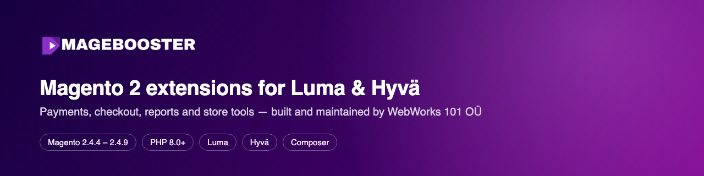

### Magento 2 extensions for Luma and Hyvä

Every extension ships in two editions: a **Luma** package and a **Hyvä** package. Install the one that matches your theme.

- **Compatibility:** Magento Open Source / Adobe Commerce / Mage-OS 2.4.4 – 2.4.9, PHP 8.0+
- **Install:** Composer (`composer require magebooster/module-…`)
- **Payments:** work on the Luma checkout, the Hyvä theme and the MageBooster Checkout

**Links:** [magebooster.com](https://magebooster.com) · [info@magebooster.com](mailto:info@magebooster.com)

MageBooster is a brand of WebWorks 101 OÜ, Tallinn, Estonia.
